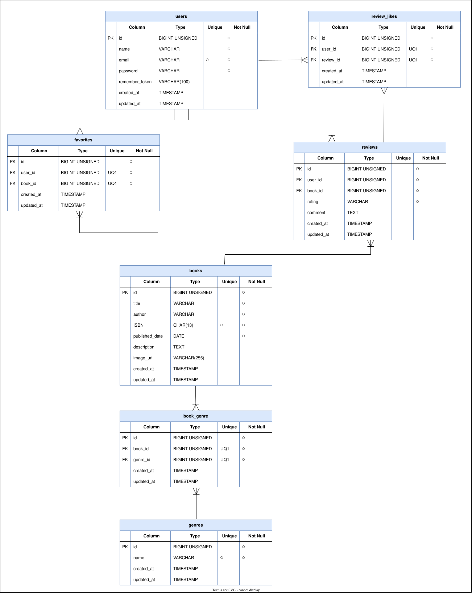
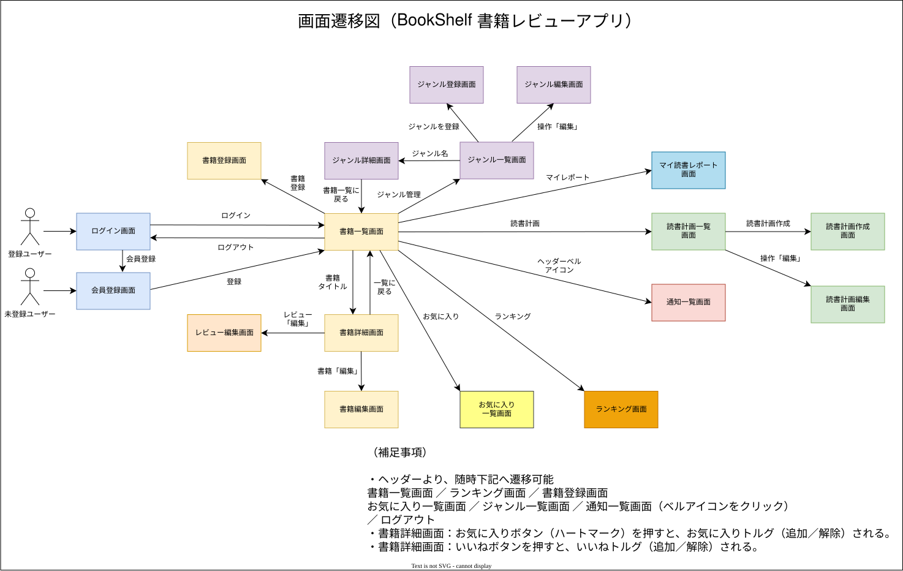

# bookshelf書籍レビューアプリ

<strong>開発者：鴨志田 悟</strong>

<strong>開発開始日：2026年11月3日</strong>

<strong>開発完了締切日：2026年12月18日</strong>

## 概要

**BookShelf 書籍レビューアプリ**
本システムは、書籍レビューアプリケーション「BookShelf」です。 
ユーザーは書籍を登録・閲覧し、レビューの投稿やお気に入り登録ができます。 
ジャンルによる分類やレビューへのいいね機能、平均評価に基づくランキング機能も備えています。 
外部アプリケーション向けの公開API（JSON）も提供します。 

## ER図

## 画面遷移図

